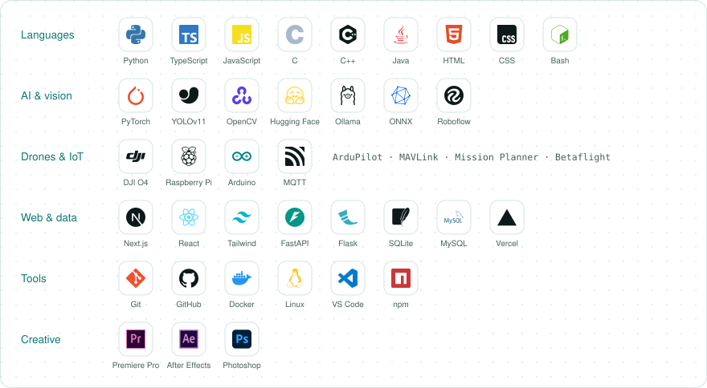
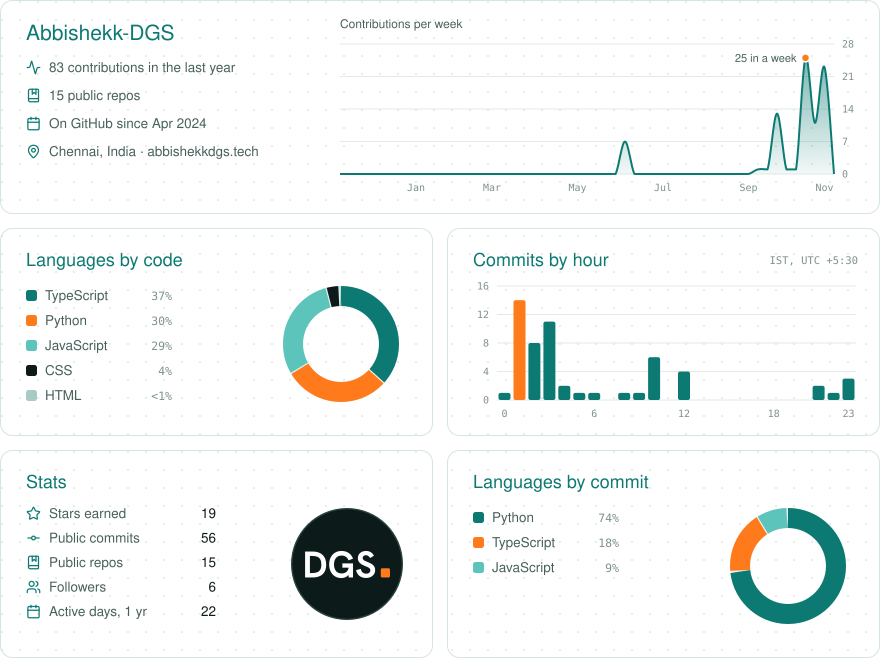
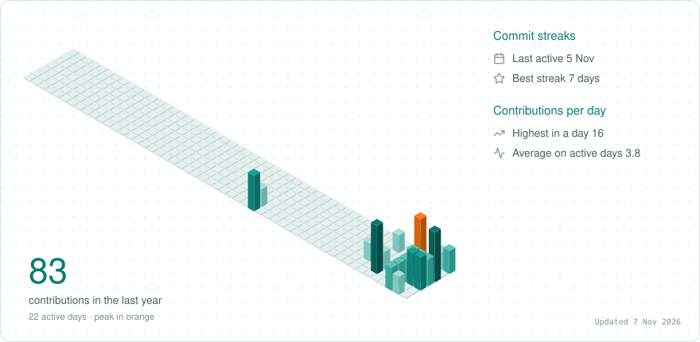
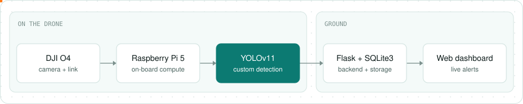

<div align="center">

<a href="https://abbishekkdgs.tech"><picture>
  <source media="(prefers-color-scheme: dark)" srcset="https://raw.githubusercontent.com/Abbishekk-DGS/Abbishekk-DGS/main/assets/v6-hero-dark.svg">
  
</picture></a>

[](https://abbishekkdgs.tech) [](https://linkedin.com/in/abbishekk-dgs) [](mailto:abbishekkdgs@gmail.com) [](https://instagram.com/abbishekk_dgs) [](https://youtube.com/@abbishekkdgs)

</div>

## About

<picture>
  <source media="(prefers-color-scheme: dark)" srcset="https://raw.githubusercontent.com/Abbishekk-DGS/Abbishekk-DGS/main/assets/v6-about-dark.svg">
  
</picture>

## Tech stack

<picture>
  <source media="(prefers-color-scheme: dark)" srcset="https://raw.githubusercontent.com/Abbishekk-DGS/Abbishekk-DGS/main/assets/v6-stack-dark.svg">
  
</picture>

## GitHub analytics

<picture>
  <source media="(prefers-color-scheme: dark)" srcset="https://raw.githubusercontent.com/Abbishekk-DGS/Abbishekk-DGS/output/analytics-dark.svg">
  
</picture>

<br>

<picture>
  <source media="(prefers-color-scheme: dark)" srcset="https://raw.githubusercontent.com/Abbishekk-DGS/Abbishekk-DGS/output/calendar-dark.svg">
  
</picture>

## Flagship · AI-Powered UAV Security Framework

Smart intrusion detection with hierarchical alert management, running on a drone. Mentored by **TU Berlin**.

<picture>
  <source media="(prefers-color-scheme: dark)" srcset="https://raw.githubusercontent.com/Abbishekk-DGS/Abbishekk-DGS/main/assets/v6-flagship-dark.svg">
  
</picture>

- Custom-trained YOLOv11 detection on board
- Zone-based intrusion detection
- Hierarchical alert escalation

> **Published · IEEE ICADCS 2026**, Vikrant University, Gwalior &nbsp;`accepted` → `presented` → `published`
>
> `UAV security` `Edge AI` `Computer vision` `Autonomous systems`

## More

<details>
<summary><b>Flight log</b></summary>
<br>

```text
2023 ──●  UAV Systems Engineer
       │  Led a surveillance UAV from design to flight testing.
       │
2024 ──●  Embedded Systems Engineer (IoT)
       │  Smart-home automation with Blynk, MQTT/HTTP and sensors.
       │
2025 ──●  Java Development Intern
          OOP, collections and exception handling.
```

</details>

<details>
<summary><b>Drones</b></summary>
<br>

| Project | What it is |
|:--|:--|
| **Semi-Autonomous Drone** | Waypoint navigation and planned missions, with the pilot able to take over at any point |
| **Surveillance Drone** | Compact airframe with a live video feed, built for GPS-denied and confined spaces |
| **Long-Range FPV Drone** | 5-inch long-range build with a payload release mechanism |
| **Cinewhoop** | Ducted FPV drone for smooth cinematic, close-proximity shots |

</details>

<details>
<summary><b>Software & automation</b></summary>
<br>

| Project | What it is |
|:--|:--|
| **Business Process Automation** | Workflows that connect systems and take repetitive manual steps out of daily operations |
| **CRM & Client Lifecycle** | One system from first enquiry to delivery: lead pipeline, automated follow-ups, full client history |

</details>

<details>
<summary><b>Embedded & IoT</b></summary>
<br>

| Project | What it is |
|:--|:--|
| **Smart Home IoT System** | Sensors and automation over Blynk and MQTT |
| **GSM Accident Alert** | Collision detection with emergency alerts |
| **RFID Security & Attendance** | Access control with live attendance tracking |

</details>

<details>
<summary><b>Open source apps</b></summary>
<br>

| Project | What it is |
|:--|:--|
| [**Fair Share**](https://github.com/Abbishekk-DGS/fair-share) | Split a bill by what each person had. [Live](https://fair-share-dgs.vercel.app) |
| [**Showrunner**](https://github.com/Abbishekk-DGS/showrunner) | A portfolio template that plays like a streaming series |

</details>

<details>
<summary><b>Certifications</b></summary>
<br>

- **IEEE ICADCS 2026**, certificate of participation
- **NPTEL**: Edge Computing, Data Mining, Industry 4.0 & Industrial IoT
- **Accenture (Forage)**: Data Analytics & Visualization
- DGCA Remote Pilot (RPAS)

</details>

<details>
<summary><b>Work with me</b></summary>
<br>

Open to UAV systems, embedded engineering and applied AI roles, research collaborations, and drone, web and aerial projects.

| Service | What you get |
|:--|:--|
| **Drone engineering** | Custom UAV builds for surveillance, delivery and autonomous missions, with flight controllers, GPS, telemetry and sensors |
| **Aerial & creative** | Aerial photography and FPV cinematography, edited in Premiere Pro |
| **Web development** | Fast, responsive websites and landing pages that are understood in seconds |
| **Automation & marketing** | Workflow automation and digital marketing campaigns for visibility |

</details>

<br>

<div align="center">

Email **[abbishekkdgs@gmail.com](mailto:abbishekkdgs@gmail.com)** &nbsp;·&nbsp; client work and reviews at **[abbishekkdgs.tech](https://abbishekkdgs.tech)**

</div>

<br>

<picture>
  <source media="(prefers-color-scheme: dark)" srcset="https://raw.githubusercontent.com/Abbishekk-DGS/Abbishekk-DGS/output/github-snake-dark.svg">
  
</picture>
